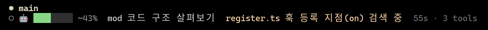

# agent-watch

A Claude Code mod that redraws each row of Claude Code's own agent list as one line: a progress bar, the task, a short summary of what the agent is doing right now, how long it has run, and how many tool calls it made.



```
◯ 🤖 ███▎     ~40%  find fields  statusline 필드를 찾는 중  1m05s · 7 tools
◯ 🤖 ██▋      1/3   fix parser  tests/parse.test.ts 실패 원인 확인 중  42s · 12 tools
```

You still select, open and stop agents in the list with the usual keys. The `main` row and the rows of a workflow keep Claude Code's own look.

## How it works

The mod hooks `agent.spawn`, `tool.call` and `turn.complete` to record each subagent's task, its latest tool calls and when it ends. A `ui.render` hook on the `AgentRow` component replaces the body of each agent row with the mod's line. The row is drawn again when the mod's state changes, and Claude Code asks for it again every 5 seconds, so the elapsed time stays current.

The summaries come from Haiku. The mod asks Haiku about an agent at most once every 20 seconds, and only after the agent has made new tool calls, so an agent that is waiting costs nothing. Haiku replies with a percent estimate and a phrase of up to 45 characters. The phrase is in Korean. To get another language, change `SYSTEM` in `hooks/register.ts`.

When the agent keeps its own task list (TaskCreate and TaskUpdate, or TodoWrite), the bar shows the finished tasks out of all tasks, such as `1/3`. Otherwise it shows Haiku's estimate with a `~` in front.

When a row is too narrow for the whole line, the mod cuts the summary first so that the time and the tool count stay visible. A row with less than 8 cells left for the summary shows none.

## Requirements

- Claude Code 2.1.326 or later, the first version with the `AgentRow` component. Tested on 2.1.327.
- Linux or macOS for the status line fallback below.

## Install

At the prompt of a terminal session:

```
/plugin install agent-watch --marketplace jaeyoon-choi/agent-watch
```

Answer `y` to add the marketplace, then pick a scope. The user scope loads the mod in every session you start after that.

From a shell:

```
claude plugin install agent-watch --marketplace jaeyoon-choi/agent-watch
```

In the desktop app, where `/plugin` does not run: click + next to the prompt box, then Plugins, Add marketplace with `jaeyoon-choi/agent-watch`, then Add plugin.

## Status line fallback

Every 5 seconds the mod also writes the rows' data to `/tmp/claude-<uid>/agent-watch/<session id>.json`. On a version without `AgentRow`, the script `statusline/agent-rows.sh` can print the same rows from that file under the status line. It needs `jq` and bash 3.2 or later.

```
curl -fsSL -o ~/.claude/agent-rows.sh https://raw.githubusercontent.com/jaeyoon-choi/agent-watch/main/statusline/agent-rows.sh
```

With no status line of your own, make the script the whole status line in `~/.claude/settings.json`:

```json
"statusLine": {
  "type": "command",
  "command": "bash ~/.claude/agent-rows.sh",
  "refreshInterval": 5
}
```

With a status line script of your own, run the row script at its end with the session id from the JSON that your script read on stdin:

```bash
session_id=$(jq -r '.session_id' <<< "$input")
bash ~/.claude/agent-rows.sh "$session_id"
```

Keep `refreshInterval` at 5 seconds or less so that the rows update while the agents work.

## Limits

- `$.agent.list()` does not list the agents that a workflow starts. The mod marks such an agent as ended when its turn completes, or after 10 minutes without a tool call if that never comes.
- Each session leaves one small file in `/tmp/claude-<uid>/agent-watch/`. The files are not deleted until `/tmp` is cleared.

## Development

```
claude plugin validate .
claude plugin test .
claude --plugin-dir .
```

The last command starts a session with the mod loaded from this folder.
